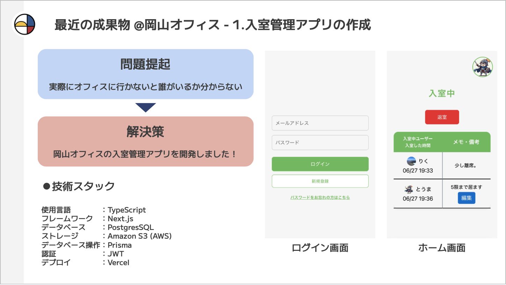
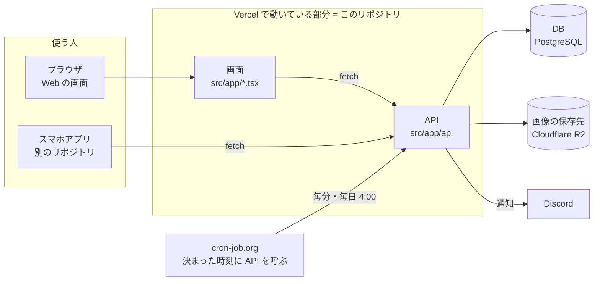
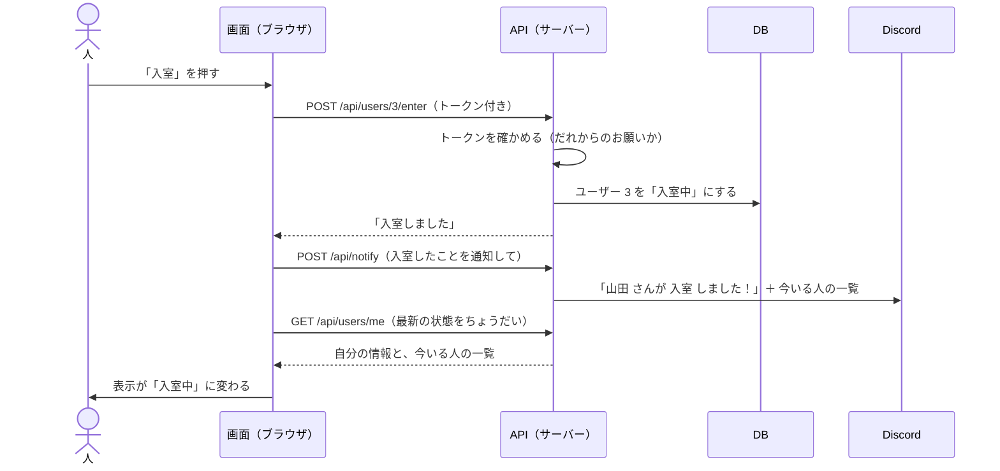
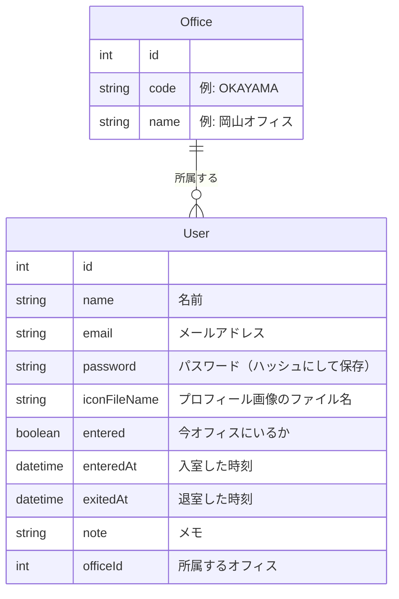
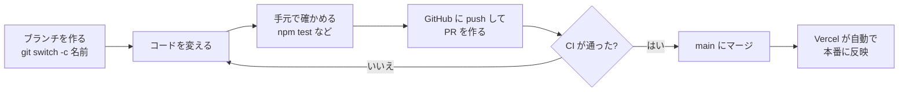

# 入退室管理（Web・API）

オフィスに「今だれがいるか」を、いつでもどこからでも確認できる Web アプリです。
IT 学生団体 PlayGround のオフィスのために作りました。



このリポジトリをコピーして、自分たちの団体用に作り直すことができます。

- このページ: アプリの全体像と、手元で動かす方法
- [docs/how-it-works.md](docs/how-it-works.md): 中のしくみ（ログイン・入退室・通知）を図で説明
- [docs/build-your-own.md](docs/build-your-own.md): 自分たちの団体用に作り直して、インターネットに公開する手順

## できること

- メールアドレスとパスワードで登録・ログインする（プロフィール画像つき）
- 「入室」「退室」ボタンで、自分がオフィスにいるかを記録する
- 同じオフィスで今いる人の一覧と、それぞれのメモ（「18 時まで作業中」など）を見る
- 入室・退室すると、Discord に「〇〇 さんが 入室 しました！」と通知が届く（今いる人の一覧つき）
- 毎日 4:00 に、退室を押し忘れた人をまとめて退室にする

## 全体の構成

このアプリは、大きく分けて「画面」「API」「DB」の 3 つでできています。



| 部分   | 役割                                                                            | どこにあるか                  |
| ------ | ------------------------------------------------------------------------------- | ----------------------------- |
| 画面   | ボタンや一覧を表示する。ブラウザで動く                                          | `src/app/page.tsx` など       |
| API    | 画面からの「入室したい」などのお願いを受けて、DB を読み書きする。サーバーで動く | `src/app/api/`                |
| DB     | ユーザーやオフィスの情報を保存しておく場所                                      | 設計は `prisma/schema.prisma` |
| Vercel | 画面と API をインターネットに公開するサービス                                   | —                             |

画面と API は、どちらも **Next.js** というフレームワークで作っていて、1 つのリポジトリに入っています。
スマホアプリ（ビーコンで自動入退室する）は別のリポジトリで、この API を使っています。Web だけでも動きます。

### 画面で「入室」を押したときに起きること



## DB に保存しているもの



パスワードはそのまま保存せず、元に戻せない形（ハッシュ）にしてから保存しています。
`User` にはほかに、スマホアプリの自動入退室で使う項目（`enterPendingSince`・`exitPendingSince`）や、パスワード再設定で使う項目があります。

## 使っている技術

| 名前                                          | 何に使っているか                                                             |
| --------------------------------------------- | ---------------------------------------------------------------------------- |
| [Next.js](https://nextjs.org/) 16             | 画面と API を作るフレームワーク（React を使う）                              |
| [TypeScript](https://www.typescriptlang.org/) | 型のある JavaScript。間違いを書いた時点で気づける                            |
| [Tailwind CSS](https://tailwindcss.com/)      | 見た目（`className='text-white bg-green-500'` のように書く）                 |
| [Prisma](https://www.prisma.io/)              | TypeScript から DB を読み書きする                                            |
| PostgreSQL                                    | DB                                                                           |
| JWT（jsonwebtoken）                           | ログインの仕組み（[how-it-works.md](docs/how-it-works.md#ログインのしくみ)） |
| bcryptjs                                      | パスワードをハッシュにする                                                   |
| sharp                                         | プロフィール画像を小さくする                                                 |
| Jest                                          | テスト                                                                       |
| Vercel                                        | インターネットへの公開                                                       |

## 手元で動かす

### 1. 必要なものを入れる

| もの           | 何に使うか                      | 入れ方                                                        |
| -------------- | ------------------------------- | ------------------------------------------------------------- |
| Node.js 22     | JavaScript を動かす             | [公式サイト](https://nodejs.org/)、または nvm・Volta など     |
| Docker Desktop | 手元で DB（PostgreSQL）を動かす | [公式サイト](https://www.docker.com/products/docker-desktop/) |
| Git            | ソースコードの管理              | Mac なら最初から入っている                                    |

### 2. 動かす

ターミナルで、このリポジトリのフォルダに入ってから、上から順に実行します。

```bash
npm ci                         # 必要なライブラリを入れる（node_modules ができる）
cp .env.example .env           # 設定ファイルを作る
```

`.env` をエディタで開き、`JWT_SECRET=` のあとに適当な長い文字列を入れます（`openssl rand -hex 32` で作れます）。

```bash
docker compose up -d           # 手元で DB を起動する
npm run db:seed                # DB の表を作り、練習用のオフィスとユーザーを入れる
npm run dev                    # アプリを起動する
```

ブラウザで http://localhost:3000 を開き、次のユーザーでログインできれば成功です。

- メールアドレス: `dev@4nonome.com`
- パスワード: `local-dev-password`

止めるときは、ターミナルで `Ctrl + C`。DB も止めるなら `docker compose down` です。

> **画像と Discord について:** 手元では、プロフィール画像は `public/icons` に保存されます。Discord の設定をしなければ通知は送られません（入退室はできます）。

### うまくいかないとき

| 症状                                                         | 確かめること                                                         |
| ------------------------------------------------------------ | -------------------------------------------------------------------- |
| `npm ci` が失敗する                                          | `node -v` が v22 になっているか                                      |
| `docker compose up -d` が失敗する                            | Docker Desktop を起動しているか                                      |
| `npm run db:seed` が「ローカルの DB ではありません」で止まる | `.env` の `DATABASE_URL` が `localhost` になっているか               |
| ログインできない                                             | `.env` に `JWT_SECRET` を入れたか。入れたら `npm run dev` をやり直す |

## よく使うコマンド

| コマンド                   | 内容                                                     |
| -------------------------- | -------------------------------------------------------- |
| `npm run dev`              | アプリを起動する（ファイルを保存すると自動で反映される） |
| `npm test`                 | テストを実行する                                         |
| `npm run test:integration` | 本物の DB を使うテスト（手元の DB の中身は消える）       |
| `npm run lint`             | 書き方の間違いを探す（ESLint）                           |
| `npm run format`           | コードの見た目を整える（Prettier）                       |
| `npm run typecheck`        | 型の間違いを探す（TypeScript）                           |
| `npm run db:seed`          | 手元の DB に練習用のデータを入れる                       |
| `npx prisma studio`        | DB の中身をブラウザで見る・書き換える                    |

## フォルダの中身

```
src/
  app/                  画面と API（フォルダの場所がそのまま URL になる）
    page.tsx              /          ホーム（入室・退室ボタン、今いる人の一覧）
    login/page.tsx        /login     ログイン
    register/page.tsx     /register  新規登録
    users/page.tsx        /users     全員の一覧
    reset-password/       /reset-password  パスワードの再設定
    api/                  API（route.ts の中の GET・POST などが、その URL の処理）
      users/[id]/enter/route.ts   POST /api/users/3/enter のように呼ぶ（[id] には数字が入る）
  components/           画面の部品（ボタン・入力欄・表など）
  lib/                  画面や API から使う処理
    attendance.ts         入退室の記録（このアプリの中心）
    http.ts               API の共通の処理（ログインの確認・エラーの返し方）
    auth.ts               ログインの仕組み（JWT）
    discord.ts            Discord への通知
    storage.ts            プロフィール画像の保存
    client/api.ts         画面から API を呼ぶ処理
prisma/
  schema.prisma         DB の設計図
  migrations/           DB の変更の履歴（自動で作られる）
openapi/openapi.yaml    API の一覧と使い方（スマホアプリ向け）
__tests__/              テスト
docs/                   説明の資料
```

Next.js では、**フォルダの場所が URL になります**。たとえば `src/app/login/page.tsx` は `/login` の画面、`src/app/api/offices/route.ts` は `/api/offices` の API です。

## コードを読む順番

1. `src/app/page.tsx` … ホームの画面。ボタンを押すと何が呼ばれるか
2. `src/lib/client/api.ts` … 画面から API を呼ぶところ
3. `src/app/api/users/[id]/enter/route.ts` … API の 1 つ。短いので全体が見える
4. `src/lib/http.ts` … どの API でも使う共通の処理
5. `src/lib/attendance.ts` … 入退室の記録の中心
6. `__tests__/` … 「こう動くはず」をコードで書いたもの。動きを知るのにも役立つ

どのファイルも、関数ごとに「何をするか」をコメントで書いています。

## 変更するときの流れ



PR を作ると、GitHub Actions（CI）が書き方・型・テストを自動で確かめます（`.github/workflows/ci.yml`）。
DB の設計（`prisma/schema.prisma`）を変えるときは [build-your-own.md の「DB の設計を変えるとき」](docs/build-your-own.md#db-の設計を変えるとき) を読んでください。

## 用語

| 用語               | 意味                                                                                 |
| ------------------ | ------------------------------------------------------------------------------------ |
| API                | 画面などから「これをして」とお願いされて、結果を返すプログラム。URL ごとに役割がある |
| GET / POST         | API へのお願いの種類。GET は「ちょうだい」、POST は「これをして・これを作って」      |
| JSON               | `{ "name": "山田" }` のような、データをやりとりする書き方                            |
| DB（データベース） | データを保存しておく場所。表（テーブル）の形で保存する                               |
| トークン           | ログインした証拠の文字列。API を呼ぶたびに付けて送る                                 |
| 環境変数           | パスワードなど、コードに書きたくない設定の値。`.env` や Vercel の設定に書く          |
| マイグレーション   | DB の表の形を変える手順。`prisma/migrations` に履歴が残る                            |
| Webhook            | 決まった URL に送るだけで、相手のサービス（Discord）にメッセージを出せる仕組み       |
| CI                 | PR を作るたびに、テストなどを自動で実行する仕組み                                    |
