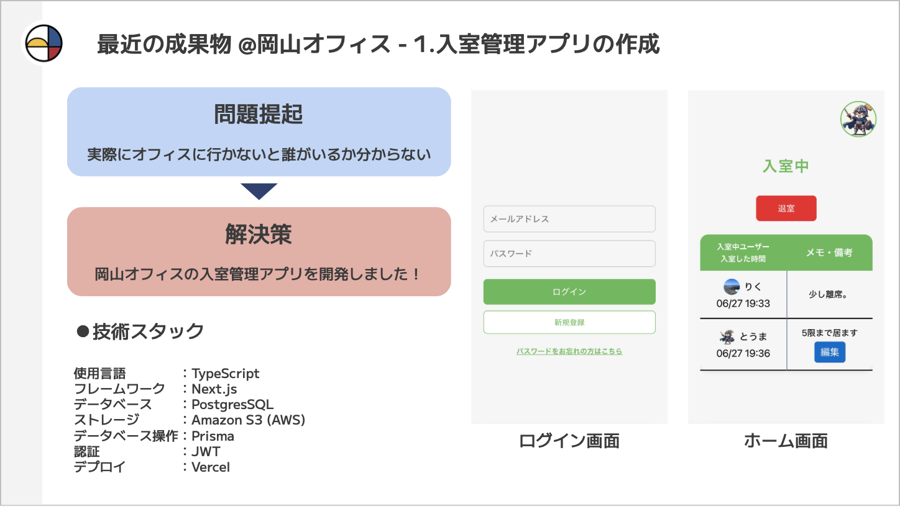

# 入退室管理（Web・API）

IT 学生団体 PlayGround のオフィスに「今だれがいるか」を、いつでもどこからでも確認できるアプリです。
このリポジトリは **Web の画面と、アプリ（iOS・Android）が使う API** です。



> 引き継ぎの全体像は [docs/handover.md](docs/handover.md)、運用の手順は [docs/operations.md](docs/operations.md) を読んでください。

## 全体の構成

リポジトリは 3 つあります。

| リポジトリ                                                                         | 内容                                                                                                    |
| ---------------------------------------------------------------------------------- | ------------------------------------------------------------------------------------------------------- |
| **okayama-office-manager**（これ）                                                 | Web の画面と API（Next.js）。Vercel で公開                                                              |
| [office-manager-native](https://github.com/toma0705/office-manager-native)         | iOS・Android アプリ（Expo / React Native）。ビーコンで自動入退室する                                    |
| [office-manager-api-client](https://github.com/toma0705/office-manager-api-client) | アプリが API を呼ぶための TypeScript クライアント。このリポジトリの `openapi/openapi.yaml` から自動生成 |

```
 iOS・Android アプリ ──┐
                        ├─→ API（このリポジトリ・Vercel）──→ DB（Prisma Postgres）
 Web の画面 ───────────┘        │
                                 ├─→ Discord（入退室の通知）
 cron-job.org（毎分・毎日 4:00）─┘   └─→ Cloudflare R2（プロフィール画像）
```

## 入退室のしくみ

入退室の記録の仕方は 2 通りあります。

- **Web の入室・退室ボタン**: すぐに入室・退室になります（`/api/users/[id]/enter`・`/exit`）。
- **アプリのビーコン検知**: すぐには入退室にせず、サーバーで「保留」にします（`/arrive`・`/leave`）。
  - 入室: 前を通っただけの人を入室にしないよう、**1 分**のあいだ圏外にならなければ確定します。
  - 退室: トイレや近くのコンビニに行っただけなら、**15 分**の猶予のあいだに戻れば取り消します。

保留は、cron-job.org が毎分呼ぶ `/api/cron/finalize-exits` と、画面を開いたときの `/api/users/me` で確定し、そのときの在室状況を添えて Discord に 1 通送ります。
退室を取りこぼした人が残らないよう、毎日 4:00 に `/api/cron/nightly-checkout` で全員を退室にします（通知はしません）。

| 状態         | `entered` | `enterPendingSince` | `exitPendingSince` |
| ------------ | --------- | ------------------- | ------------------ |
| 退室中       | false     | null                | null               |
| 入室の保留中 | false     | 圏内になった時刻    | null               |
| 入室中       | true      | null                | null               |
| 退室の保留中 | true      | null                | 圏外になった時刻   |

コードは [src/lib/attendance.ts](src/lib/attendance.ts) にまとまっています。

## 技術スタック

| 項目           | 使っているもの                                               |
| -------------- | ------------------------------------------------------------ |
| フレームワーク | Next.js 16（App Router）・React 19・TypeScript               |
| DB             | PostgreSQL（Prisma Postgres）・Prisma 6                      |
| 認証           | JWT（180 日有効。アプリはほとんど開かれないため長め）        |
| 画像           | Cloudflare R2（S3 互換）。200KB 以下に圧縮（sharp）          |
| メール         | Nodemailer（パスワード再設定）                               |
| 通知           | Discord Webhook                                              |
| 公開           | Vercel（main にマージすると本番に反映、PR ごとにプレビュー） |
| テスト         | Jest（単体テスト・本物の Postgres を使う結合テスト）         |
| CI             | GitHub Actions                                               |

## 開発を始める

Node.js 22 と Docker が必要です。

```bash
npm ci
cp .env.example .env           # JWT_SECRET などを入れる（Prisma も Next.js も .env を読む）
docker compose up -d           # ローカルの Postgres を起動
npm run db:seed                # マイグレーションと、開発用のオフィス・ユーザーを入れる
npm run dev                    # http://localhost:3000
```

開発用のユーザーは `dev@4nonome.com` / `local-dev-password` です（[prisma/seed.sql](prisma/seed.sql)）。

> **注意:** 本番の値（とくに `DATABASE_URL`）をローカルの `.env` に入れないでください。`prisma migrate dev` などが本番の DB を書き換えてしまいます。本番の値は Vercel にだけ置きます（`db:seed` と結合テストは、ローカル以外の DB では実行しないようにしています）。

## よく使うコマンド

| コマンド                   | 内容                                                                                 |
| -------------------------- | ------------------------------------------------------------------------------------ |
| `npm run dev`              | 開発サーバー                                                                         |
| `npm test`                 | 単体テスト                                                                           |
| `npm run test:coverage`    | 単体テスト（カバレッジ付き。`coverage/index.html`）                                  |
| `npm run test:integration` | 結合テスト（ローカルの Postgres が必要。DB の中身は消える）                          |
| `npm run lint`             | ESLint                                                                               |
| `npm run format`           | Prettier で整形                                                                      |
| `npm run typecheck`        | 型チェック                                                                           |
| `npm run db:seed`          | ローカルの DB に開発用のデータを入れる                                               |
| `npm run openapi:generate` | `openapi/openapi.yaml` から api-client を生成（`../api-client` に出力。Java が必要） |

## テストと CI

- **単体テスト**（`__tests__/unit`）: Prisma をモックして、ルートと `src/lib` の動きを確かめます。カバレッジが下がると CI が落ちます。
- **結合テスト**（`__tests__/integration`）: 本物の Postgres で、入室の保留 → 確定 → 退室の保留 → 確定 → 夜間の一括退室の流れと、アプリが呼ぶ API を通します。
- **OpenAPI のテスト**（`__tests__/unit/openapi.test.ts`）: 実装したルートと `openapi/openapi.yaml` が一致しているかを確かめます。ルートを足したら仕様も足してください。

PR を作ると GitHub Actions（[.github/workflows/ci.yml](.github/workflows/ci.yml)）が次を実行します。ビルドは Vercel のプレビューで確かめています。

| ジョブ                      | 内容                                                                                               |
| --------------------------- | -------------------------------------------------------------------------------------------------- |
| Lint・整形・型チェック      | ESLint・Prettier・tsc                                                                              |
| テスト・DB マイグレーション | マイグレーションが空の DB に適用できるか・`schema.prisma` と一致しているか、単体テスト、結合テスト |

## ディレクトリ構成

```
src/
  app/
    api/            API（route.ts）。1 ファイル = 1 つの URL
    page.tsx など   Web の画面
  components/       画面の部品
  lib/
    attendance.ts   入退室の記録・保留の確定（中心となる処理）
    http.ts         API ルートの共通処理（認証・エラー応答など）
    user.ts         ユーザー情報の変換（パスワードを返さない・画像の URL）
    discord.ts      Discord への通知
    storage.ts      プロフィール画像の保存（R2）
    client/api.ts   Web の画面から API を呼ぶ処理
  types/api.ts      Web の画面で使う API の型
prisma/
  schema.prisma     DB の設計
  migrations/       DB の変更履歴
openapi/
  openapi.yaml      API の仕様（api-client の元）
__tests__/          テスト
docs/               引き継ぎ資料・運用の手順
```

API ルートは、[src/lib/http.ts](src/lib/http.ts) の `handleRoute` で包み、「入力の確認 → 認証 → 本処理」の順に書きます。失敗は `HttpError` を投げると、そのステータスのレスポンスになります。

```ts
export const POST = handleRoute('入室に失敗しました', async (req: NextRequest, context: IdContext) => {
  const userId = await parseIdParam(context); // 数値でなければ 400
  requireSelf(req, userId);                   // トークンがなければ 401、他人なら 403
  const user = await findUserOrThrow(userId); // いなければ 404
  ...
});
```

## API を変えるとき

1. `src/app/api` のルートを変える（テストも足す）
2. `openapi/openapi.yaml` を合わせて直す（`openapi.test.ts` が確かめる）。互換性のない変更なら `info.version` の先頭の数字を上げる
3. main にマージすると、GitHub Actions が api-client に PR を作る → マージするとタグが付く
4. アプリ（native）の `package.json` の api-client のタグを書き換える

## DB（スキーマ）を変えるとき

1. `prisma/schema.prisma` を直し、`npx prisma migrate dev --name <内容>` でマイグレーションを作る（ローカルの DB で）
2. PR を作る（CI が、空の DB に適用できるか・schema と一致しているかを確かめる）
3. **マージの前に**、本番の DB に適用する: `DATABASE_URL=<本番の値> npx prisma migrate deploy`
   - 列の追加は先に適用しても、今動いているコードに影響しません。列の削除は、その列を使わないコードを先に本番に出してから適用します
4. マージする（Vercel が本番に反映）

ビルドではマイグレーションを実行しません。詳しくは [docs/operations.md](docs/operations.md)。

## 環境変数

見本は [.env.example](.env.example) です。本番の値は Vercel の Environment Variables にあります。

| 名前                                                                                                              | 用途                                                             |
| ----------------------------------------------------------------------------------------------------------------- | ---------------------------------------------------------------- |
| `DATABASE_URL`                                                                                                    | DB の接続先                                                      |
| `JWT_SECRET`                                                                                                      | ログイン用トークンの署名鍵（変えると全員がログインし直しになる） |
| `CRON_SECRET`                                                                                                     | cron-job.org から呼ぶ API の秘密の値                             |
| `DISCORD_WEBHOOK_URL_DEFAULT` / `DISCORD_WEBHOOK_URL_<オフィスのコード>`                                          | Discord の通知先                                                 |
| `R2_PUBLIC_URL` / `R2_S3_ENDPOINT` / `R2_ACCESS_KEY_ID` / `R2_SECRET_ACCESS_KEY` / `R2_BUCKET_NAME` / `R2_REGION` | プロフィール画像の保存先（Cloudflare R2）                        |
| `NEXT_PUBLIC_URL` / `SMTP_*`                                                                                      | パスワード再設定メール                                           |
