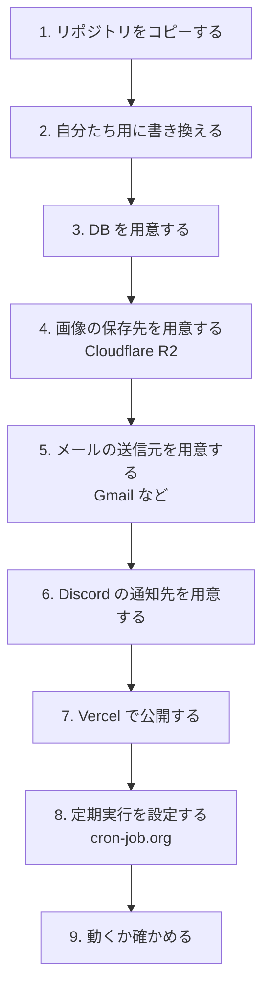
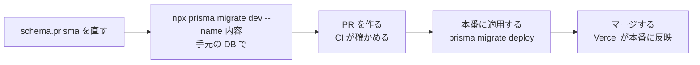

# 自分たちの団体用に作り直す

このリポジトリをコピーして、自分たちの団体用の入退室管理をインターネットに公開するまでの手順です。
ほとんどのサービスは無料の範囲で使えます。まず README の「手元で動かす」で、手元で動くことを確かめてから進めてください。

## 全体の流れ



公開したあとに必要な作業は、このページの後半（[動かし続けるために](#動かし続けるために)）にあります。

## 1. リポジトリをコピーする

1. GitHub で、自分たちの空のリポジトリを作る（README などは作らない）
2. ターミナルで次を実行する（`<自分たちのリポジトリの URL>` は作ったリポジトリの URL）

```bash
git clone https://github.com/toma0705/okayama-office-manager.git my-office-manager
cd my-office-manager
git remote set-url origin <自分たちのリポジトリの URL>
git push -u origin main
```

これで、履歴ごと自分たちのリポジトリにコピーできます。PR を作ると、自分たちのリポジトリでも CI（テストなど）が自動で動きます。

## 2. 自分たち用に書き換える

| ファイル               | 書き換える内容                                                            |
| ---------------------- | ------------------------------------------------------------------------- |
| `src/lib/constants.ts` | 登録できるメールアドレスのドメイン（`@4nonome.com` → 自分たちのドメイン） |
| `prisma/seed.sql`      | 練習用のオフィスとユーザー（メールアドレスのドメインも合わせる）          |
| `src/app/layout.tsx`   | ブラウザのタブに出るアプリの名前                                          |
| `openapi/openapi.yaml` | `servers` の URL（公開したあとの URL）と、説明の中のドメイン              |
| `README.md`            | 団体名・画面の画像など                                                    |

次のファイルは、元のスマホアプリのためのものなので、**消してください**。

| ファイル                           | 理由                                                                                                                       |
| ---------------------------------- | -------------------------------------------------------------------------------------------------------------------------- |
| `.github/workflows/api-client.yml` | 元の作者の api-client（スマホアプリ用のクライアント）を更新する仕組み。コピーでは動かず、`openapi/` を変えるたびに失敗する |

`openapi/generate.mjs` と `npm run openapi:generate` も、スマホアプリを作らないなら使いません（残しておいても害はありません）。

書き換えたら、`npm test` が通ることを確かめて、コミットします。

## 3. DB を用意する

PostgreSQL の DB をインターネット上に用意します。元のアプリは **Prisma Postgres**（[Prisma Data Platform](https://console.prisma.io/)）を使っています。Neon や Supabase などの PostgreSQL でも動きます。

1. サービスに登録して、DB を作る
2. 接続用の URL（`postgresql://...` または `prisma+postgres://...`）をコピーする。これが `DATABASE_URL` になる
3. 手元のターミナルで、表を作る（マイグレーションを適用する）

```bash
DATABASE_URL='<コピーした URL>' npx prisma migrate deploy
```

4. オフィスを登録する。次のコマンドでブラウザに DB の画面が開くので、`Office` の表に行を足す（`code` は英大文字で `OKAYAMA` のように、`name` は表示名）

```bash
DATABASE_URL='<コピーした URL>' npx prisma studio
```

> **注意:** 本番の `DATABASE_URL` を、手元の `.env` に書かないでください。手元のテストや作業で本番のデータを消してしまうことがあります。本番の値は Vercel にだけ置きます。

## 4. 画像の保存先を用意する（Cloudflare R2）

Vercel では、サーバーにファイルを保存しても消えてしまいます。プロフィール画像は [Cloudflare R2](https://www.cloudflare.com/ja-jp/developer-platform/products/r2/) に保存します（月 10GB まで無料）。

1. Cloudflare に登録し、R2 で**バケット**（ファイルを入れる箱）を作る
2. バケットの設定で、公開用の URL を有効にする（`https://pub-xxxx.r2.dev` のような URL）→ `R2_PUBLIC_URL`
3. R2 の「API トークンを管理」で、そのバケットに読み書きできるトークンを作る → `R2_ACCESS_KEY_ID`・`R2_SECRET_ACCESS_KEY`
4. S3 互換の接続先（`https://<アカウント ID>.r2.cloudflarestorage.com`）→ `R2_S3_ENDPOINT`
5. バケットの名前 → `R2_BUCKET_NAME`、`R2_REGION` は `auto`

設定しないと、本番では新規登録（画像のアップロード）が失敗します。

## 5. メールの送信元を用意する（パスワード再設定）

パスワードを忘れた人に、再設定のメールを送るために使います。Gmail を使う場合:

1. 送信元にする Google アカウントで 2 段階認証を有効にする
2. Google アカウントの「アプリ パスワード」を作る
3. 環境変数: `SMTP_HOST=smtp.gmail.com`、`SMTP_PORT=587`、`SMTP_USER=<Gmail のアドレス>`、`SMTP_PASS=<アプリ パスワード>`、`SMTP_FROM=<Gmail のアドレス>`

## 6. Discord の通知先を用意する

1. 通知を流したい Discord のチャンネルの設定 → 連携サービス → ウェブフック → 新しいウェブフック
2. 「ウェブフック URL をコピー」→ `DISCORD_WEBHOOK_URL_DEFAULT`
3. オフィスごとにチャンネルを分けたいときは、`DISCORD_WEBHOOK_URL_<オフィスのコード>`（例: `DISCORD_WEBHOOK_URL_OKAYAMA`）を足す

## 7. Vercel で公開する

1. [Vercel](https://vercel.com/) に GitHub のアカウントで登録する
2. 「Add New → Project」で、自分たちのリポジトリを選ぶ（設定はそのままで Next.js と認識される）
3. 「Environment Variables」に、下の表の値を入れて「Deploy」

| 名前                                                                                                    | 値                                                                                     |
| ------------------------------------------------------------------------------------------------------- | -------------------------------------------------------------------------------------- |
| `DATABASE_URL`                                                                                          | 3 でコピーした URL                                                                     |
| `JWT_SECRET`                                                                                            | 長いランダムな文字列（`openssl rand -hex 32`）。手元の `.env` とは別の値にする         |
| `CRON_SECRET`                                                                                           | 長いランダムな文字列（`openssl rand -hex 32`）。8 で使う                               |
| `R2_PUBLIC_URL` `R2_S3_ENDPOINT` `R2_ACCESS_KEY_ID` `R2_SECRET_ACCESS_KEY` `R2_BUCKET_NAME` `R2_REGION` | 4 の値                                                                                 |
| `NEXT_PUBLIC_URL`                                                                                       | 公開した URL（例: `https://my-office-manager.vercel.app`）。再設定メールのリンクに使う |
| `SMTP_HOST` `SMTP_PORT` `SMTP_USER` `SMTP_PASS` `SMTP_FROM`                                             | 5 の値                                                                                 |
| `DISCORD_WEBHOOK_URL_DEFAULT`（と `_<コード>`）                                                         | 6 の値                                                                                 |

これで、`https://<プロジェクト名>.vercel.app` で公開されます。以後、main にマージするたびに自動で反映されます。
環境変数をあとから変えたときは、Vercel の Deployments から「Redeploy」しないと反映されません。

## 8. 定期実行を設定する（cron-job.org）

Vercel の無料プランでは、決まった時刻に処理を動かす機能が 1 日 1 回までしか使えないので、[cron-job.org](https://cron-job.org/)（無料）から API を呼びます。

ジョブを 2 つ作ります。どちらも「ADVANCED」の Headers に、Key `Authorization`、Value `Bearer <CRON_SECRET の値>`（Bearer のあとに半角スペース）を足します。

| ジョブ     | URL                                                | 実行のタイミング                          |
| ---------- | -------------------------------------------------- | ----------------------------------------- |
| 保留の確定 | `https://<公開した URL>/api/cron/finalize-exits`   | 毎分（Every minute）                      |
| 一括退室   | `https://<公開した URL>/api/cron/nightly-checkout` | 毎日 4:00（タイムゾーンを Asia/Tokyo に） |

- 保留の確定は、スマホアプリの自動入退室を使わないなら、なくても動きます（Web のボタンはすぐに反映されるため）。
- **一括退室のジョブで「TEST RUN」を押すと、その場で全員が退室になります。** 日中は押さないでください。

## 9. 動くか確かめる

- [ ] 公開した URL で新規登録できる（画像も表示される）
- [ ] ログインして、入室・退室できる
- [ ] Discord に通知が届く
- [ ] 「パスワードをお忘れの方はこちら」でメールが届き、再設定できる
- [ ] cron-job.org の実行履歴で、ジョブが 200 を返している

## 動かし続けるために

### DB の設計を変えるとき



1. `prisma/schema.prisma` を直し、`npx prisma migrate dev --name <変更の内容>` を実行する（手元の DB に適用され、`prisma/migrations` に履歴が増える）
2. PR を作る。CI が、空の DB に適用できるか・schema と一致しているかを確かめる
3. **マージの前に**、本番の DB に適用する: `DATABASE_URL='<本番の値>' npx prisma migrate deploy`
4. マージする

- 列や表を**足す**ときは、先に本番に適用しても、今動いているアプリは困りません。
- 列や表を**消す**ときは逆です。その列を使わないコードを先にマージして本番に出してから、適用します。

### オフィスを増やす

1. `npx prisma studio` を本番の `DATABASE_URL` で開き、`Office` に行を足す
2. 通知先を分けるなら、Vercel に `DISCORD_WEBHOOK_URL_<コード>` を足して Redeploy

### 秘密の値を変える

| 値                 | 変えたときの影響                                 |
| ------------------ | ------------------------------------------------ |
| `JWT_SECRET`       | 全員のログインが切れる（ログインし直せば使える） |
| `CRON_SECRET`      | cron-job.org の 2 つのジョブのヘッダーも変える   |
| `DATABASE_URL`     | Vercel を更新して Redeploy                       |
| Discord の Webhook | 作り直したら Vercel を更新して Redeploy          |

### 困ったとき

| 症状                                                       | 確かめること                                                                                         |
| ---------------------------------------------------------- | ---------------------------------------------------------------------------------------------------- |
| 画面にエラーが出る・動かない                               | Vercel のプロジェクトの「Logs」に、エラーの内容が出ている                                            |
| だれかがずっと入室中のまま                                 | 毎日 4:00 の一括退室で消える。すぐ消すなら本人が退室ボタンを押す                                     |
| Discord に通知が来ない                                     | Webhook の URL が消されていないか。Vercel の Logs に「Discord への通知に失敗しました」が出ていないか |
| 新規登録で「プロフィール画像のアップロードに失敗しました」 | Vercel の `R2_*` の値                                                                                |
| 再設定のメールが届かない                                   | Vercel の `SMTP_*` の値。迷惑メールのフォルダ                                                        |
| cron-job.org のジョブが 401                                | ヘッダーの `CRON_SECRET` が Vercel の値と同じか                                                      |

### 定期的にやること

- **依存の更新**: `npm outdated` で古いライブラリを確かめ、上げたら `npm test` と Vercel のプレビューで確かめる
- **Node.js のバージョン**: `.nvmrc` のバージョンのサポート期限が近づいたら上げる（CI と Vercel の設定も）
