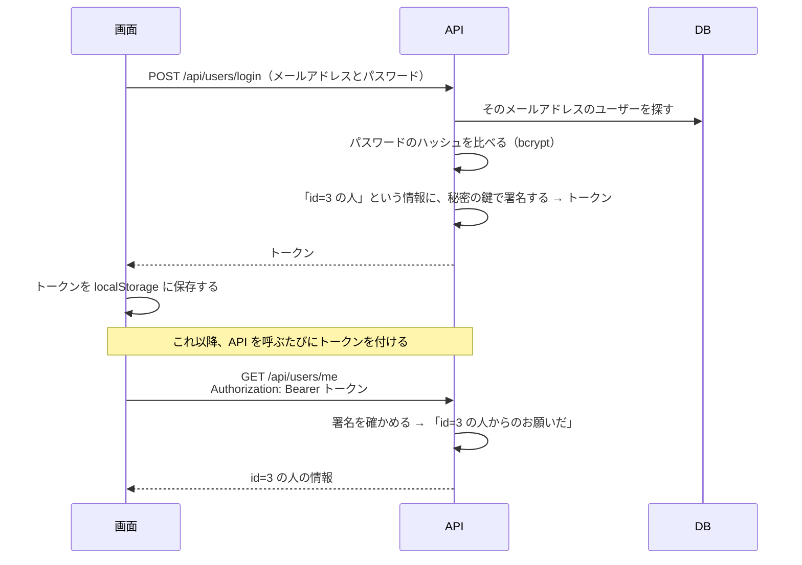
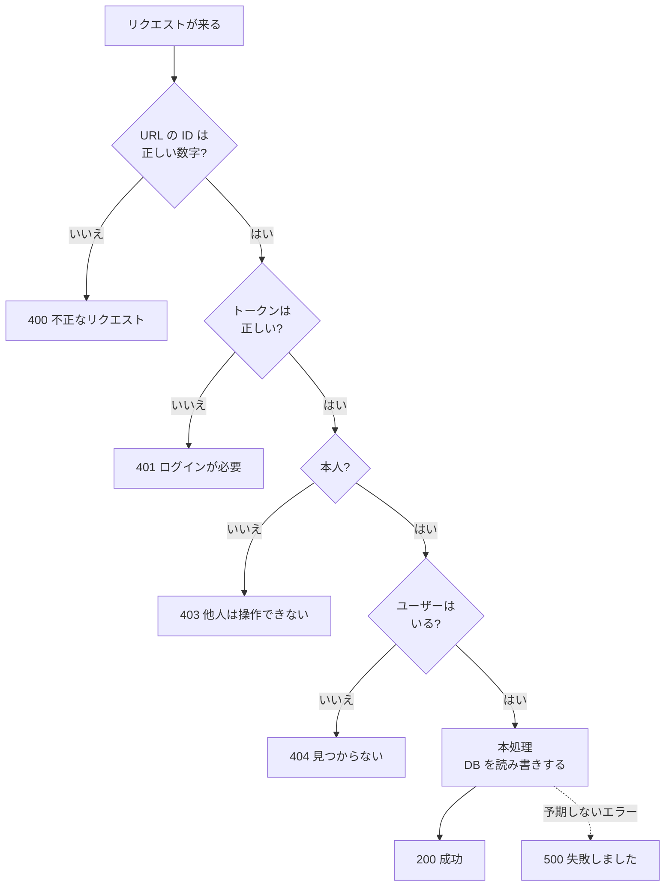
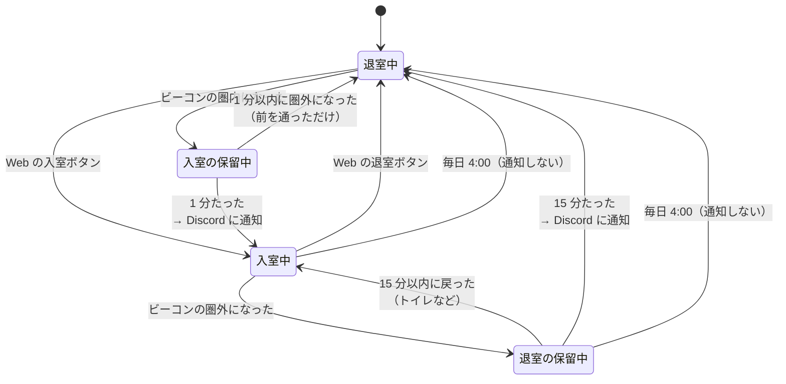
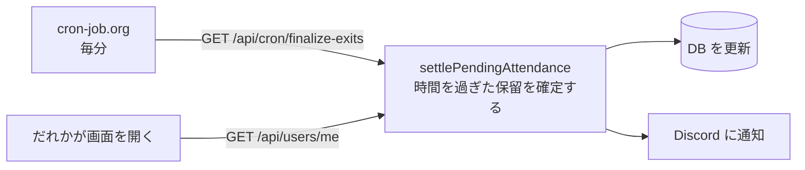
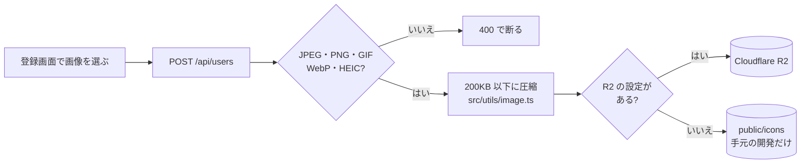

# しくみの説明

README の全体像の続きです。ログイン、API の書き方、入退室の記録、通知、定期実行のしくみを、図を使って説明します。

## ログインのしくみ

ログインには **JWT（ジェイダブリューティー）** という仕組みを使っています。



- **秘密の鍵**は環境変数 `JWT_SECRET` です。この鍵を知らないと正しい署名は作れないので、トークンを書き換えて他人になりすますことはできません。
- トークンは 180 日で期限が切れます。切れたらログインし直します。
- コード: 発行は `src/app/api/users/login/route.ts`、確かめるのは `src/lib/auth.ts` と `src/lib/http.ts` の `requireAuth`。

**パスワードの保存:** パスワードは bcrypt で「ハッシュ」という、元に戻せない文字列にしてから DB に入れます。ログインのときは、入力されたパスワードを同じ方法でハッシュにして比べます。DB が漏れても、パスワードそのものは分かりません。

## API の書き方

API は `src/app/api/<URL>/route.ts` に書きます。中で `GET` や `POST` という名前で関数を書き出すと、その URL にその種類のお願いが来たときに呼ばれます。

どの API も、`src/lib/http.ts` の部品を使って、次の順に書いています。



実際のコード（`src/app/api/users/[id]/exit/route.ts`）はこれだけです。

```ts
export const POST = handleRoute('退室処理に失敗しました', async (req, context) => {
  const userId = await parseIdParam(context); // 数字でなければ 400
  requireSelf(req, userId); // トークンがなければ 401、他人なら 403

  const exited = await exitNow(await findUserOrThrow(userId)); // いなければ 404
  if (!exited) throw new HttpError(400, 'すでに退室済みです');
  return NextResponse.json({ message: '退室しました' });
});
```

途中でうまくいかないときは `throw new HttpError(ステータス, メッセージ)` と書くと、`handleRoute` がそのステータスの応答（`{ "error": "メッセージ" }`）にしてくれます。

### ステータスコード

| 番号 | 意味                     | 例                                     |
| ---- | ------------------------ | -------------------------------------- |
| 200  | 成功                     | 入室できた                             |
| 201  | 作った                   | ユーザーを登録した                     |
| 400  | お願いの中身がおかしい   | 必須の項目がない                       |
| 401  | ログインしていない       | トークンがない・期限切れ               |
| 403  | その操作は許されていない | 他人の入室を押そうとした               |
| 404  | 見つからない             | そのユーザーはいない                   |
| 409  | ぶつかった               | そのメールアドレスはもう登録されている |
| 500  | サーバーの中でエラー     | DB に繋がらない                        |

## API の一覧

| URL                                 | 種類               | 内容                                           | ログイン                 |
| ----------------------------------- | ------------------ | ---------------------------------------------- | ------------------------ |
| `/api/users/login`                  | POST               | ログインしてトークンをもらう                   | 不要                     |
| `/api/users`                        | POST               | 新規登録                                       | 不要                     |
| `/api/users`                        | GET                | ユーザーの一覧                                 | 必要                     |
| `/api/users/me`                     | GET                | 自分の情報と、同じオフィスで今いる人の一覧     | 必要                     |
| `/api/users/[id]`                   | GET・PATCH・DELETE | 自分の情報の取得・メモの更新・アカウントの削除 | 本人のみ                 |
| `/api/users/[id]/enter`             | POST               | 入室（Web のボタン）                           | 本人のみ                 |
| `/api/users/[id]/exit`              | POST               | 退室（Web のボタン）                           | 本人のみ                 |
| `/api/users/[id]/arrive`            | POST               | ビーコンの圏内になった（スマホアプリ）         | 本人のみ                 |
| `/api/users/[id]/leave`             | POST               | ビーコンの圏外になった（スマホアプリ）         | 本人のみ                 |
| `/api/notify`                       | POST               | Discord に通知する                             | 必要                     |
| `/api/offices`                      | GET                | オフィスの一覧                                 | 不要                     |
| `/api/users/reset-password-request` | POST               | パスワード再設定のメールを送る                 | 不要                     |
| `/api/users/reset-password/[token]` | POST               | パスワードを再設定する                         | 不要（メールのトークン） |
| `/api/cron/finalize-exits`          | GET                | 保留の確定（毎分）                             | 定期実行の秘密の値       |
| `/api/cron/nightly-checkout`        | GET                | 全員を退室にする（毎日 4:00）                  | 定期実行の秘密の値       |
| `/api/warmup`                       | GET・HEAD          | DB への接続を先に作る・動いているかの確認      | 不要                     |

詳しい入力と出力は `openapi/openapi.yaml` に書いてあります（OpenAPI という形式）。

## 入退室の記録

入退室の記録の仕方は 2 通りあります。どちらも `src/lib/attendance.ts` に書いてあります。

- **Web のボタン**: 押したらすぐに入室・退室になります（`enterNow`・`exitNow`）。
- **スマホアプリのビーコン検知**: すぐには入退室にせず、いったん「保留」にします（`arrive`・`leave`）。オフィスの前を通っただけ、トイレに行っただけ、で入退室にならないようにするためです。

### 状態の移り変わり



DB では、この 4 つの状態を 3 つの項目の組み合わせで表しています。

| 状態         | `entered` | `enterPendingSince` | `exitPendingSince` |
| ------------ | --------- | ------------------- | ------------------ |
| 退室中       | false     | 空                  | 空                 |
| 入室の保留中 | false     | 圏内になった時刻    | 空                 |
| 入室中       | true      | 空                  | 空                 |
| 退室の保留中 | true      | 空                  | 圏外になった時刻   |

### 保留をだれが確定するのか

保留は、時間がたっただけでは確定しません。だれかが「時間を過ぎた保留を確定して」とお願いする必要があります。それをしているのが次の 2 つです。



同時に 2 回呼ばれても、確定と通知は 1 回だけになるように作っています（`attendance.ts` の `updateMany` の条件）。

## Discord への通知

Discord の **Webhook** を使っています。チャンネルの設定で作れる専用の URL で、そこに JSON を送るとメッセージが投稿されます。

```
山田 さんが 入室 しました！
┃ 📍 岡山オフィスの在室状況（2人）
┃ 🟢 山田　10:30〜
┃ 🟢 佐藤　11:00〜
```

- オフィスごとに送り先を分けられます（環境変数 `DISCORD_WEBHOOK_URL_<オフィスのコード>`。なければ `DISCORD_WEBHOOK_URL_DEFAULT`）。
- メモに `@everyone` と書かれても、メンションとして鳴らないようにしています。
- 通知に失敗しても、入退室の記録は成功させます（ログに残すだけ）。
- コード: `src/lib/discord.ts`

## 定期実行

Vercel の無料プランでは、決まった時刻に処理を動かす機能が 1 日 1 回までしか使えません。そこで、**cron-job.org**（決まった時刻に URL を呼んでくれる無料のサービス）から API を呼んでいます。

| いつ      | 呼ぶ URL                     | すること                                               |
| --------- | ---------------------------- | ------------------------------------------------------ |
| 毎分      | `/api/cron/finalize-exits`   | 時間を過ぎた保留を確定し、Discord に通知する           |
| 毎日 4:00 | `/api/cron/nightly-checkout` | 入室中のままの人を全員退室にする（退室の押し忘れ対策） |

だれでも呼べてしまうと困るので、ヘッダーに `Authorization: Bearer <CRON_SECRET>` を付けたときだけ動くようにしています（`src/lib/http.ts` の `requireCronSecret`）。

## プロフィール画像



DB には画像そのものではなく、保存先でのファイル名だけを入れています。表示するときに URL にします（`src/lib/storage.ts`）。

## テスト

| 種類             | 場所                             | 内容                                                                      |
| ---------------- | -------------------------------- | ------------------------------------------------------------------------- |
| 単体テスト       | `__tests__/unit`                 | 関数や API を 1 つずつ確かめる。DB は本物を使わず「モック（偽物）」にする |
| 結合テスト       | `__tests__/integration`          | 本物の DB で、入室の保留 → 確定 → 退室までの流れを通して確かめる          |
| OpenAPI のテスト | `__tests__/unit/openapi.test.ts` | `src/app/api` の API と `openapi/openapi.yaml` の一覧が同じか確かめる     |

テストは「この関数にこれを渡したら、こうなるはず」をコードで書いたものです。コードを変えたあとに `npm test` を実行すれば、壊れていないかすぐに分かります。
